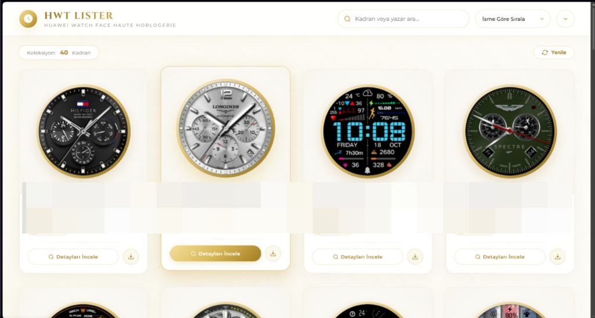

<div align="center">

# ⌚ HWT Lister — Huawei Watch Face Gallery

**A luxury white & gold themed web application designed to list, preview, filter, and inspect Huawei smartwatch `.hwt` watch face packages.**

[](https://www.python.org/)
[](https://flask.palletsprojects.com/)
[](LICENSE)

<br/>



</div>

---

## ✨ Highlights & Features

- **🏛️ Single-File Simplicity (`app.py`):** Backend and Frontend are unified within a single lightweight Flask file. No complex builds, no multiple processes. Run one command, and your default browser opens automatically.
- **💎 Luxury White & Gold Haute Horlogerie Theme:** Inspired by prestigious luxury watchmakers (Rolex, Patek Philippe, Cartier). Features gold bezel case styling, glassmorphism blur effects, and refined typography with `Cinzel` & `Montserrat`.
- **🔍 Real-Time Search & Smart Filtering:** Instant live filtering by watch face name, designer, or XML content. Multi-attribute sorting by name, file size, modification date, and image asset count.
- **🖼️ Intelligent Preview & Asset Extraction:**
  - Automatically identifies official Huawei Theme Studio vitrine covers (`preview/cover.jpg`, `cover.png`, or `icon_small.jpg`).
  - **Always-On-Display (AOD) Shield:** Prevents pitch-black standby screen images (designed for AMOLED battery saving) from being mistakenly chosen as the main cover.
  - Dedicated AOD toggle: If a standby display exists, it is marked with an **"AOD MEVCUT"** badge and can be viewed via an interactive tab in the inspection modal.
  - Automatic color space normalization to standard web RGB JPEG/PNG with intelligent disk caching (`cache/`).
- **📊 Comprehensive XML & Metadata Inspection:** Deep-parses `description.xml` and `watch_face_config.xml` to display watch face title, author, screen resolution, target devices, and internal archive file manifests.
- **📥 One-Click Direct Download:** Easily download `.hwt` files directly through the web UI to install on your smartwatch.

---

## 🚀 Quick Start Guide

### 1. Requirements

- Python 3.8+
- Dependencies: `flask`, `Pillow`

Install required packages:

```bash
pip install -r requirements.txt
```

### 2. Add Your Watch Face Files

Place your `.hwt` watch face files inside the `hwt/` directory:

```
HWT Lister/
│
├── hwt/                       <-- Put your .hwt files here
│   ├── RolexDaytona.hwt
│   ├── CasioVintage.hwt
│   └── ...
├── assets/
│   └── gallery-preview.png
├── app.py
├── requirements.txt
└── README.md
```

### 3. Launch

```bash
python app.py
```

The server will initialize and automatically open `http://localhost:5000` in your default web browser.

---

## 🛠️ How It Works Under the Hood

1. **What is an HWT file?** Huawei watch faces (`.hwt`) are specialized ZIP archives containing compiled watch face components, configuration XML files, graphical PNG assets, and showcase preview images.
2. `app.py` scans both `hwt/` and `.hwt/` directories dynamically.
3. The extraction engine uses priority-weighted heuristics to pull the sharpest showcase image without extracting unnecessary assets.
4. XML configurations are parsed recursively to extract relevant designer, resolution, and version information.
5. Cached previews are served instantaneously with zero overhead on subsequent visits.

---

## 📸 Screenshots

| Main Gallery View |
|:---:|
|  |

---

## 📦 License

This project is open-source and licensed under the [MIT License](LICENSE).
